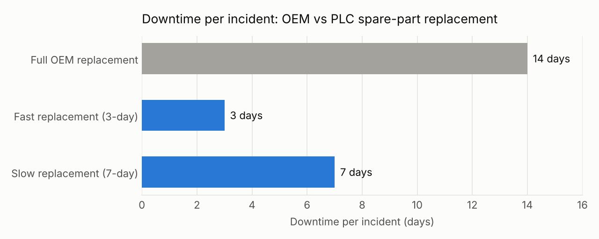
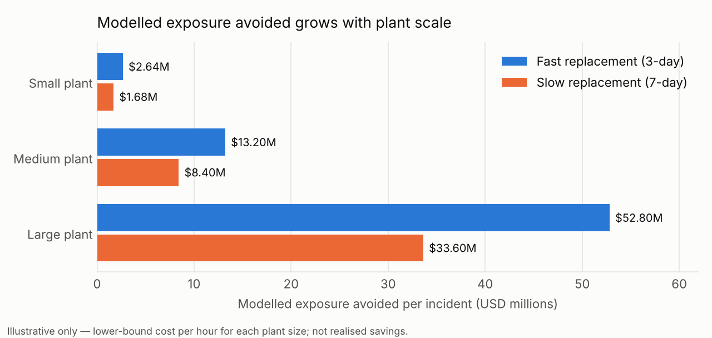

# G.R.A.C.E.

### Measuring Sustainable Asset Lifecycle Value

> **Project type:** Engineering consulting · Industrial automation · Downtime and cost-impact modelling
> **Industry partner:** PLC Automation (industrial automation and obsolete PLC spare-parts supplier)
> **My role:** Team Leader; Cost Quantification & Modelling Lead
> **Team:** Team 1 (5 members): Min Xi, Jia Qi, Shrujan, Asyhiddiq, Guru
> **Status:** Completed academic consulting project

A consulting framework that helps an industrial spare-parts supplier **measure and communicate** the sustainability and financial value of extending equipment life, instead of leaving that value implied. The core of the project is a transparent, scenario-based model that turns *days of downtime avoided* into *financial exposure avoided*.

---

## 1. Context

When a programmable logic controller (PLC) or control component fails or becomes obsolete, a plant usually has two options:

| | Full OEM replacement | Spare-part replacement (PLC Automation) |
|---|---|---|
| Scope | Replace the whole machine or system | Replace the specific failed part |
| Modelled downtime | 14 days, full plant shutdown | 1–7 days, often a system-specific shutdown* |
| Restart | Full plant restart | Partial restart* |
| Waste | Whole machine retired | Machine life extended, less waste |

\*Whether a partial shutdown is possible depends on the plant's architecture, redundancy and safety isolation. See [assumptions](docs/assumptions-and-limitations.md).

PLC Automation already creates this value for clients (faster delivery, extended asset life, less waste, a circular-economy model), **but it had no systematic way to quantify it or present it credibly** to customers and stakeholders. Operational data was also split across several spreadsheets.

## 2. Problem Statement

> *How might PLC Automation systematically capture and quantify the sustainability impact of its asset life-extension and component reuse practices, and communicate this value credibly to customers and stakeholders, without disrupting its fast-paced, demand-driven supply chain operations?*

## 3. The G.R.A.C.E. Framework

Five pillars of measurable indicators. Full detail in [`docs/grace-framework.md`](docs/grace-framework.md).

| Pillar | What it measures | Example metrics |
|---|---|---|
| **G**ratification | Client and employee trust and satisfaction | Customer / employee satisfaction %, repeat purchase rate |
| **R**ecycling | Material recovery and waste avoided | Recovery rate (% of parts salvaged instead of discarded) |
| **A**ccountability | Product quality and responsiveness | Warranty claim rate, improvement rate, complaint resolution rate |
| **C**ost & downtime savings | Time and money clients avoid losing | Downtime avoided (days/hours), exposure avoided ($) |
| **E**xperience | How the impact is communicated | Website impact dashboard, downloadable reports, social media |

## 4. Cost & Downtime Model (my main contribution)

Full derivation in [`docs/methodology.md`](docs/methodology.md). Runnable model: [`analysis/scenario_model.py`](analysis/scenario_model.py).

**Formulas**

```
ΔD           = D_OEM − D_PLC                 # downtime avoided (days)
D_reduction  = ΔD / D_OEM × 100%             # downtime reduction (%)
C_savings    = ΔD × C_day                    # exposure avoided ($)
C_day        = cost of breakdown per hour × 24
```

**Inputs**: D_OEM = 14 days (fixed reference); D_PLC = 3 days (fast case) and 7 days (slow case); breakdown cost per hour set at the **lower end** of each plant-size range, to stay conservative.



**Results (per incident, illustrative)**

| Plant scale | Breakdown cost used | Fast case (3 days) ΔD = 11 d, −78.6% | Slow case (7 days) ΔD = 7 d, −50% |
|---|---|---|---|
| Small (10–49 staff) | $10,000 / hr | **$2.64M** | **$1.68M** |
| Medium (50–249 staff) | $50,000 / hr | **$13.2M** | **$8.4M** |
| Large (250+ staff) | $200,000 / hr | **$52.8M** | **$33.6M** |



**Takeaway:** in the modelled cases, spare-part replacement cuts downtime by **50–79% per incident**. Because the model is linear, exposure avoided grows in proportion to plant scale and to days avoided. At large scale, shorter downtime acts as capital protection, not just an efficiency gain.

> ⚠️ These are **modelled exposure-avoided estimates, not realised savings**. See [`docs/assumptions-and-limitations.md`](docs/assumptions-and-limitations.md).

### From model to operations: the downtime master sheet

To move from illustrative scenarios to real figures, we proposed one **centralised master spreadsheet** to replace the fragmented ones:

1. Tag each part sold with an **impact level** (high-value parts are visible at a glance).
2. Record **time saved (hours)** per part per customer, and average it by industry.
3. Roll up time saved **per customer and per period** (monthly, quarterly, yearly).
4. Multiply by each customer's **industry-specific downtime cost** to get attributed cost savings. *Example: a part that saves a client 150 hours at $100,000/hr ≈ $15M of downtime exposure avoided.*

## 5. Communicating Impact (Experience)

- **Website:** shift from service descriptions to an outcome-led homepage with quantified impact tiles (% downtime reduction, exposure avoided, average recovery days, machines supported).
- **Reports:** a downloadable "Operational Impact Summary" / sustainability report with downtime, cost and recovery breakdowns. It can be printed as a client pamphlet.
- **Social media:** short, visual posts of impact metrics to build credibility through regular, transparent updates.

## 6. Implementation Roadmap

| Phase | Timing | What happens |
|---|---|---|
| 1. ESG data collection (pilot) | First 2 weeks | Pilot on ~4 client datasets; calculate downtime and cost savings in Excel |
| 2. Data capture SOP | Next 2 weeks | Standardise capture; integrate ESG metrics into the website dashboard |
| 3. Larger-scale implementation | Next 4 weeks | Expand to ~10 client datasets; compute mean/median savings; find gaps |
| 4. Full rollout | Thereafter | All clients captured; collate ESG data every 2 weeks; update dashboard monthly |

## 7. My Role

As **team leader**, I coordinated the project's direction and shaped how the service's value would be framed for stakeholders. As **cost quantification and modelling lead**, I:

- built the calculation logic linking downtime avoided to financial exposure avoided (ΔD, D_reduction, C_savings);
- structured the small-, medium- and large-plant scenarios and the fast vs slow replacement cases;
- turned the calculations into presentation-ready charts and impact statements;
- made the assumptions explicit so the conclusions stay defensible for a non-technical audience.

## 8. Repository Structure

```text
G.R.A.C.E/
├── README.md
├── docs/
│   ├── grace-framework.md              # all five pillars and their metrics
│   ├── methodology.md                  # cost/downtime model, worked examples
│   └── assumptions-and-limitations.md  # what the numbers do and don't mean
├── analysis/
│   ├── scenario_model.py               # reproduces every figure and chart
│   └── scenario_results.csv            # model output
└── visuals/
    ├── downtime-comparison.png
    └── exposure-by-plant-scale.png
```

Reproduce the results:

```bash
pip install matplotlib
python analysis/scenario_model.py
```

## 9. Disclaimer

This was an academic consulting exercise. All financial figures are illustrative scenario outputs based on stated assumptions. They are not verified client savings, and they are not an endorsement by or official statement from PLC Automation. Client names and internal data have been left out.

---

**Topics:** `industrial-automation` · `engineering-consulting` · `downtime-analysis` · `cost-modelling` · `scenario-analysis` · `esg` · `sustainability` · `circular-economy`
